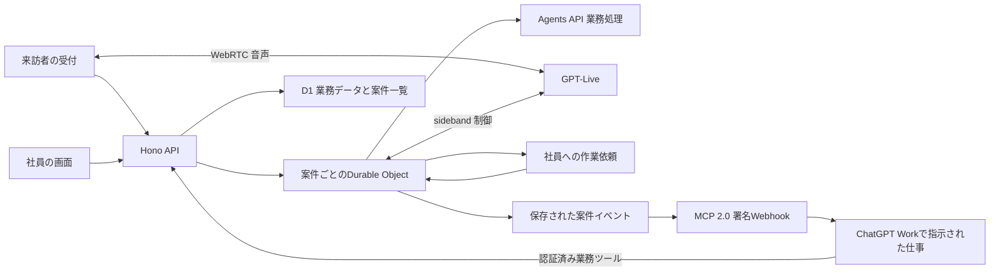

# future-company 実装マスタ

2026-10-18作成。公開受付から会社の仕事を進め、社員の回答を同じ会話へ戻すための設計提案。
実装済みの範囲と接続試験の結果は、作業一覧と完了報告で区別する。

## 1. 体験と完了条件

来訪者は会社のサイトから音声またはテキストで相談する。
AIは確認できた商品・注文・会社情報を使って仕事を進める。
現物確認や例外判断は社員へ依頼し、回答を受けて案内を続ける。
問い合わせ、商談、採用は同じ案件の仕組みを使う。

主デモは、壊れた商品を翌日のイベントで使いたい相談とする。
注文照合、交換条件の取得、社員への在庫確認依頼、社員回答、交換案、来訪者による選択、対応結果保存までが同じ案件につながれば成立する。
人へ直接話したい場合は、作業依頼と別の通話引き継ぎへ分岐する。
黒電話側は別担当が実装する。バックエンドは依頼と回答の接点を提供する。

## 2. 確認した既存構成

- ローカルの`r74`ブランチにHonoとCloudflare Vite pluginの雛形がある。`src/index.tsx`がWorker入口、`src/renderer.tsx`がHono JSXのHTML描画。
- ローカルのpackageには`dev`、`build`、`preview`、`deploy`、`cf-typegen`がある。Reactアプリではない。
- FE担当の`codex/frontend-setup`は別の構成。GitHubで確認したコミットは`805e7db9d24e8f5884a09cf01f1e17f188000e4d`。
- FEは`frontend/`のReact 19、TypeScript 6、Vite 8とnpm workspace。`components`、`hooks`、`lib`、`types`は置き場のみで、API処理はまだない。
- FEの型チェック・lint・build済みという共有は受け取った。該当コミットのcheck-runs、Actions、statusには実行記録がなかったため、実行結果は今回検証していない。

FEを作り直さず、`frontend/src/lib`にHTTP接続、`hooks`に案件同期、`types`に契約を追加する。
FEブランチをローカルへ重ねるとルートのpackageとREADMEが競合するため、統合はその差分を読んでから行う。
本番のブラウザ通信は同一オリジンの`/api/v1`と`/mcp`を使う。
開発中の別ポート接続はVite proxyを使い、`VITE_`変数へ秘密情報を入れない。

## 3. バックエンドの責任

Honoは認証、入力検証、API経路、OpenAIへの接続、業務ツールの窓口を持つ。
案件DOは会話、調査結果、社員依頼、重複命令、進行状態の正本を持つ。
D1は会社・商品・注文・業務結果と、社員の案件一覧用の要約を持つ。
一覧はD1の要約、引き受け・回答・案件詳細はDOの最新状態を使う。
モデルの文章は業務処理の完了証拠にしない。

## 4. 案件と状態

提案する識別子は`caseId`、`commandId`、`requestId`、`agentSessionId`、`liveSessionId`。
会話の訂正や用件変更では`revision`を更新し、古い調査結果を現在の提案へ適用しない。

| 対象 | 状態の意味 |
| --- | --- |
| 案件 | 用件受付、調査、提案提示、対応結果の保存、終了 |
| 業務処理 | 実行待ち、実行中、社員回答待ち、成功、失敗、取消 |
| 社員依頼 | 依頼中、引き受け済み、回答済み、取消 |
| 通話 | 参加要求、接続交渉、接続成立、終了、接続失敗 |

社員の現物確認を待つ間も来訪者との会話を続けるので、これらを単一のstatusへ押し込めない。
社員依頼には`summary`、`facts`、`question`、`expectedAnswer`、`department`を持たせる。
事実には出所、取得時点、対象レコードを添える。
通知を出したこと、電話側が受領したこと、社員が引き受けたことを別々に記録する。

## 5. 更新・同期・DO課金

- 命令は`commandId`と`expectedRevision`を持つ。同じ命令の再送では最初の結果を返す。別内容で同じIDを再利用したら拒否する。
- 重複確認をrevision確認より先に行い、処理済み命令を再送しても競合扱いで詰まらないようにする。
- 引き受けと回答はDOで保存する。二人の同時引き受けでは一人だけが担当になる。
- WebSocketはHibernation APIを使う。受付と社員に別の公開フィールドを返し、社員メモや注文の秘密情報を来訪者へ配信しない。
- 再接続では認可をやり直し、最新snapshotを返す。ブラウザの状態を正本へ上書きしない。
- D1要約にはrevisionを持たせ、遅れて到着した古い更新で新しい要約を上書きしない。
- 定期polling、`setInterval`、独自ping、無限retryをDOへ入れない。今回の業務APIは受信命令で動かし、常駐alarmを作らない。
- 後続で再試行alarmを使う処理は、未完了仕事、回数上限、期限を保存する。成功・取消・上限到達で終了し、仕事がなければalarmを再予約しない。
- Liveの外向きWebSocketは音声セッション中だけ保ち、終了・切断で閉じる。音声接続中もDOが休眠できるとは扱わない。

Hibernationでメモリ上の値は失われるため、案件をDO storage、接続のactorをattachmentへ保存する。
受信側WebSocketと外向きWebSocketの休眠条件は異なる。[Cloudflare WebSockets](https://developers.cloudflare.com/durable-objects/best-practices/websockets/)
alarmを使う後続処理はat-least-once実行を前提に重複排除する。[Alarms](https://developers.cloudflare.com/durable-objects/api/alarms/)

## 6. APIと業務ツール

次は新規APIの提案であり、既存APIの一覧ではない。

| 経路 | 利用者と動作 |
| --- | --- |
| `POST /api/v1/cases` | 来訪者。案件を作る |
| `GET /api/v1/cases/:caseId` | 案件所有者または社員。現在状態を読む |
| `POST /api/v1/cases/:caseId/messages` | 案件所有者。テキストの用件や訂正を保存する |
| `GET /api/v1/cases/:caseId/ws` | 認可済みの参加者。状態を購読する |
| `POST /api/v1/cases/:caseId/investigate` | 案件所有者。注文の照合と交換条件取得を行う |
| `GET /api/v1/staff/cases` | 社員。D1の案件一覧を読む |
| `POST /api/v1/staff/requests/:requestId/claim` | 社員。依頼を引き受ける |
| `POST /api/v1/staff/requests/:requestId/answer` | 担当社員。調査・判断結果を回答する |
| `POST /api/v1/cases/:caseId/live` | 案件所有者。SDP offerを送りLive音声セッションを作る |
| `POST /api/v1/cases/:caseId/agent` | 案件所有者。保存済み文脈から業務処理を開始・継続する |
| `POST /webhooks/openai` | OpenAI。署名を検証した状態変更を受ける |
| `POST /mcp` | 認証済み連携。業務ツールとMCP Eventsを提供する |

入力はJSON schema相当の実行時検証を行い、本文サイズと文字数を制限する。
HTTPエラーはProblem Detailsを使い、認可失敗、revision競合、外部接続不足、業務情報なしを区別する。
API境界の日時はUTCのRFC 3339とする。

業務ツールは、会社情報取得、商品取得、注文照合、交換条件取得、社員依頼作成、社員回答取得、提案保存、来訪者の確定操作、対応結果保存を提供する。
商談では要望を集めて提案を保存し、採用では希望と面談内容を保存して社員へ渡す。
部署は用件に基づいて選ぶが、誤分類は同じ案件内で訂正する。
注文の閲覧は注文番号だけで許可しない。架空デモでは閲覧コードを照合する。
交換、商談、採用の確定は、サーバーが持つ提案ID・現在revision・来訪者の確認を照合して実行する。

## 7. 認証と保存

来訪者はランダムなHttpOnly cookieのセッションで自分の案件へだけアクセスする。
状態変更ではOriginを検証する。WebSocketも接続時にcookieとOriginを検証する。
社員認証は認証済みprincipalを返す検証関数として注入する。接続設定がない環境では社員APIを閉じる。
社員・MCP・業務AIのprincipalは互いに流用しない。
部署や案件の権限はAPIと業務ツールの両方で検証し、クライアントやモデルが申告したroleを信頼しない。

| 保存先 | 内容 |
| --- | --- |
| 案件DO | 会話、資料、調査結果、社員依頼、revision、command結果、AI再開待ち |
| D1業務データ | 会社説明、商品、注文と交換規則、確定した対応結果 |
| D1案件一覧 | caseId、kind、部署、要約、revision、更新日時 |
| D1連携データ | Agentsと案件の対応、MCP購読、配信イベントと試行結果 |

raw音声を独自に録音保存する処理は今回作らない。会話・応募内容の保存期間と削除方針は公開前に会社担当と合意する。
架空デモデータは架空と表示し、実顧客の情報を投入しない。

## 8. GPT-LiveとAgents API

Liveは話し方、追加質問、割り込みを扱い、業務ルールはバックエンドへ置く。
WorkerがSDPをOpenAIへ渡し、ブラウザはWebRTCで音声を送受信する。[WebRTC](https://developers.openai.com/api/docs/guides/voice-webrtc)
sidebandはサーバー側で会話イベントを受け、委譲とツール実行を一度だけ扱う。[Server-side controls](https://developers.openai.com/api/docs/guides/voice-server-controls)

client delegationではアプリが会話文脈と案件状態を準備する。
`session.delegation.created`のIDを保存し、確認済み結果を`session.commentary.append`で返す。
静かな進捗や次の返答用の事実は`session.thinking.append`を使う。
ブラウザからの任意の履歴をsystem指示へ変換しない。[Live delegation](https://developers.openai.com/api/docs/guides/live-delegation)

Agentsのsession IDを案件へ結びつけ、社員回答と用件訂正を同じsessionへ入力する。
長い仕事をHTTP応答後の無制限な`waitUntil`へ任せず、公式session状態とWebhookを使って再開する。
Webhookはraw bodyで署名検証し、保存済みsessionとの対応を確認してから案件へ渡す。
`agent.session.idle`だけで成功にしない。turnの結果とツールの実行結果を読む。[Session webhooks](https://developers.openai.com/api/docs/guides/agents-api/sessions/webhooks)

OpenAI secretはWorkerだけに置く。配布キーを使うことはユーザーが承認済みで、現在のローカル設定にキーはない。
モデルと権限は配布プロジェクトで接続試験する。未接続では明示的な接続エラーを返し、AIが調査したような成功文を作らない。

## 9. MCP Eventsで仕事を起動する

DevDay 2026の公開資料は、MCPイベントを監視し、合致したイベントでChatGPTが行動する用途を示している。[DevDay公式更新](https://learn.chatgpt.com/docs/whats-new/devday-2026)
ChatGPT向けのMCP 2.0対応はprotocol `2026-07-28`と署名Webhookで実装する。
`server/discover`、`events/list`、`events/subscribe`、`events/unsubscribe`を認証済み`/mcp`へ置く。
購読したWorkチャットで、利用者が指定した仕事が進む。[MCP Events](https://developers.openai.com/plugins/build/mcp-events)

公開イベント案は`case.created`、`human_request.created`、`case.resolved`。
状態の保存後に発行し、イベントには案件ID、revision、部署、短い要約、社内URLを持たせる。
全文は認証済み`get_case`ツールで読む。
購読、期限、配信状態を永続化し、フィルタとprincipal権限を配信前に検証する。
Webhook受領とChatGPTの仕事完了は分ける。
重複イベントや自分の処理で同じ仕事が再発火しないよう、発生元と命令IDで同一処理を識別する。

callback接続の安全条件を満たすtransportが注入されていなければ購読を成立させない。
任意URLをそのまま`fetch`する実装を採用しない。
接続時IP検証とDNS rebinding防止はWorkers上で実証してから配信を有効にする。
再送は同じイベントIDで有限回だけ行い、上限到達では配信失敗を残す。
イベント配信が失敗しても案件対応を失敗扱いへ巻き戻さない。

## 10. 画面と人への引き継ぎ

公開サイトは白系背景、黒い本文、朱色の操作ボタンとし、中央に受付を開く入口を置く。
英語を既定にし、日本語へ切り替えても案件や通話を作り直さない。
受付は会話と資料を並べ、スマホでは会話を中心に資料を下から開く。
社員画面は案件一覧、会話・処理履歴、作業依頼の三列とする。

作業依頼ではAIが来訪者との会話を続け、社員の回答後に業務処理を再開する。
通話引き継ぎでは参加者を認可し、双方向音声が成立してからAI音声の再生を止める。
接続失敗ではAI対応を継続する。音声再生の停止はブラウザでも実行し、AIへの指示だけに頼らない。
人同士の音声はWebRTC、SDP・ICEの交換は案件WebSocketを使う。
TURNを使う接続試験では、同一LANだけでなく中継が必要な条件も通す。[Cloudflare TURN](https://developers.cloudflare.com/realtime/turn/)

## 11. 接続試験で証明すること

認可された案件作成、注文照合、社員の同時引き受け、回答、再接続、重複命令、古い結果の拒否を試験する。
音声ではマイク拒否、割り込み、会話中の業務処理、社員回答の反映、通話失敗と終了を試す。
MCPは実際のWorkチャットで発見、購読、callback検証、イベント受領、仕事起動、業務ツール実行までを確認する。
待機中にDOのアラームが予約されず、同一命令で処理件数が増えないことを検証する。
型チェックやローカルテストだけで音声、黒電話、ChatGPT起動、Cloudflareの請求額を検証済みにしない。

