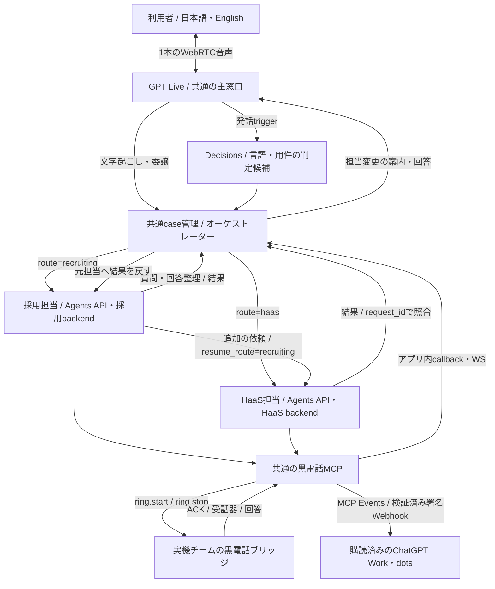

# 14:45 設計会議 — 共通GPT Live窓口、採用、HaaS

2026-10-18 / 会議用の構成案。14:35時点のチーム共有を基に整理。

**今日決めたいこと：1本のGPT Live会話を保ち、採用とHaaSの2ルートを共通の依頼・結果でつなぐ。** 採用担当の画面・バックエンドと、採用以外の依頼を扱うHaaSを並行して進める。担当変更は音声で案内し、人間への相談は共通の黒電話MCPへ渡す。

この資料の「案」は未合意・未接続を含む。GitHubの実装状況、実APIの疎通、ブラウザ音声往復、実機のベル・通話は別の確認として扱う。

## 1. 1本の主音声と2つの業務ルート【案】

- **主窓口はGPT Liveに統一。** 画面を移るたびに別通話を開始しない。採用・HaaSは業務文脈を持つ別セッション／アダプターとして接続する。
- **総合受付**は言語と用件を確認する。曖昧な依頼は短く聞き返す。採用は `recruiting`、採用以外の判断・仕事依頼は `haas` へ渡す。
- **採用担当**は面談の質問、回答の整理、不足情報の確認、人間への相談を行う。採否は人が判断する。
- **HaaS担当**は採用以外の依頼の整理・判断・実行依頼を扱う。採用担当からの追加依頼も受け、結果を元担当へ戻す。自動実行できる範囲と人間に依頼する範囲を明示する。
- **音声で引継ぎを案内。** 「採用担当におつなぎします」「この件はHaaS担当に確認します」「結果が届いたので、採用の続きに戻ります」。同じLive音声で担当の違いを伝える。声自体の変更は今日の必須条件にしない案。
- **黒電話は共通サービス。** 各業務から同じMCP契約を呼び、同じ相談の再送で二重に鳴らさない。

現在のNode試作のルーティングは `reception` / `recruiting`。**`haas` と元担当への復帰は、この会議で追加する案**であり、接続済みとは扱わない。

## 2. 共通の依頼・結果と会話の復帰【案】

画面、Workers、Node、MCPが同じ識別子で状況を追えるようにする。既存APIのURLは維持し、まずこのenvelopeをアダプターで合わせる。最終のURL・保存先は会議で決める。

| 共通フィールド | 意味 |
| --- | --- |
| `case_id` | 主音声の会話・案件。担当変更でも維持 |
| `request_id` | 1件の業務依頼。結果と再送の照合単位 |
| `parent_request_id` | 採用からHaaSへ追加依頼した場合の元依頼。直接の依頼では省略 |
| `route` | 今回依頼する担当：`recruiting` / `haas` |
| `resume_route` | 完了後に会話を戻す担当：`reception` / `recruiting` / `haas` |
| `language` | `ja` / `en`。利用者の発話から更新し、担当を越えて保持 |
| `summary` / `input` | 用件、確認済みの回答、担当が必要とする情報。全文履歴の無条件転送はしない |
| `idempotency_key` | 同じ依頼の再送で固定。新しい依頼には新しい値 |
| `status` / `result` | `requested` → `working` → `needs_human` / `completed` / `failed` / `cancelled` と結果本文 |
| `handoff_id` | 黒電話へ相談したときのMCP側識別子。`request_id`との対応を保存 |

**復帰例：** 採用の `request_id=R1` から、`parent_request_id=R1`、`request_id=H1`、`route=haas`、`resume_route=recruiting` で相談する。H1の結果をcaseへ保存し、採用担当に渡す。その後Liveが結果と次の質問を読み上げる。結果が届く前に利用者が取り消した場合は、古い結果で会話を勝手に切り替えない。

`completed` は結果本文まで揃った業務の完了を表す。黒電話の `accepted` は受話器応答であり、業務結果や人間との音声接続の完了に読み替えない。相談が不在・失敗した場合はその状態を利用者に説明し、元担当の文脈を保つ。

## 3. 接続境界とイベント

| 境界 | 契約・使い方 | 現在地 |
| --- | --- | --- |
| FE → Live作成 | `POST /api/live/session` `{sdp, language, case_id?}` → `{session:{id}, transport:{sdp}, case_id}` | Node試作にあり。pupu側の共通音声画面への組込みは合流対象 |
| FE → Live終了 | `DELETE /api/live/session/:id` | Node試作にあり。マイク停止、業務取消、リソース終了を一緒に確認 |
| Live → オーケストレーター | 文字起こし・委譲・sideband | Nodeで実API疎通の確認報告あり。Workers側sidebandは未接続 |
| オーケストレーター ↔ 採用/HaaS | 上記 `request/result` envelope | [Issue #8](https://github.com/pupuchan1/future-company/issues/8) の共通契約へ合流する案 |
| FEへ通知 | `GET /api/events` のSSE：`routing.updated`、`backend.*`、`human.*`、文字起こし | Nodeにあり。実装間でpayloadと案件フィルターを統一する |
| 業務担当 → 黒電話 | MCP `request_human` / 状態取得 / 取消 | NodeでMCP・模擬ベルの動作確認報告。実機接続は別 |
| 黒電話 → 業務担当 | callback/WS → case更新 → Agents入力 → Live回答 | 受話器状態と回答本文は別。回答本文の接続を追加中 |
| 外部購読者へ通知 | MCP Eventsの購読検証・署名付きHTTPS Webhook | ローカルWebhook試験済み。実Work/dots購読は未接続 |

| イベント | 主要フィールド／必要な振る舞い |
| --- | --- |
| `routing.updated` | `case_id, request_id?, route, resume_route?, language, source`。`haas`は追加案。UIと音声案内を同じ切替に合わせる |
| `session.input_transcript.delta` / `session.output_transcript.delta` | `event_id, delta, start_ms, end_ms, case_id`。会話表示、二重受信の排除 |
| `backend.started` / `backend.result` / `backend.error` | `case_id, request_id, route` と結果／エラー。結果を対応する依頼へ戻す |
| `human.requested/ringing/accepted/completed/unavailable/cancelled` | `case_id, handoff_id, status, simulated, revision`。`request_id`との対応は共通caseが管理 |
| 人間の回答【追加案】 | `case_id, request_id, handoff_id, result`。受話器状態だけから回答を生成しない |

**MCP EventsはLive内の自動イベントバスではない。** 通常のMCP tool result、アプリ内SSE/WS、Agentsストリーム、外部購読者へのMCP Eventsを分ける。主音声への結果返却をWork/dotsの購読成功に依存させない。Webhookを受信した事実と、その先の仕事の完了も区別する。

## 4. いま進んでいる実装と合流点

以下は14:35時点のチーム共有・Issue情報。相手のローカル差分を取得・実行したという意味ではない。

| 作業 | 状況 | 次の合流点 |
| --- | --- | --- |
| [#6 バックエンド](https://github.com/pupuchan1/future-company/issues/6) / r74tech | Workers・Hono・Durable Objects・D1、社員の引受・回答APIをローカル実装中、未push。Live sideband未接続。結果データは在庫前提 | push後に既存契約を確認。採用/HaaSの汎用 `request/result` へ合わせ、共通caseを保存する境界を決定 |
| [#7 フロント](https://github.com/pupuchan1/future-company/issues/7) / pupu | 受付・共通音声・結果・operatorの4画面。言語は発話から推定する方針。声切替は未決 | Live作成/終了とSSEを共通音声画面へ接続。operatorの回答を `request_id` 付きで戻す |
| [#9 フロント試作](https://github.com/pupuchan1/future-company/issues/9) / pupu | 黒・青・白、角丸なし。localStorageと別タブのモックを試作中 | モックデータ源を実API/SSEへ差し替える。ブラウザ内の同期をサーバーの受付・完了と混同しない |
| [#4 Node接続試作](https://github.com/pupuchan1/future-company/issues/4) | Live実API・Agents API・MCP模擬ベルの動作確認報告あり。人間回答本文を追加中 | 動く接続例としてFE/Workersへ受け渡す。HaaSルートと復帰を追加し、既存実装の移植範囲を絞る |
| [#8 共通request/result](https://github.com/pupuchan1/future-company/issues/8) | 共通の依頼・結果の提案 | この会議で識別子・payload・状態・結果の復帰先を固定 |
| 黒電話の実機 | 実機チームが担当。共通MCPへ接続する前提 | 模擬と実機を `simulated` で区別。ベル、受話器、回答、実音声を順に確認 |

**開発の共有先はこの `future-company`。本番リポジトリはGOROmanさんが別途作る前提で、現在は未接続。** ローカル試作と共有済みコード、本番稼働を別に記録する。

## 5. 14:45に決める5点

1. **共通caseの正本と接続順。** Workers/DO/D1を正本にしNodeを接続例として移すか、今日のデモはNodeを経由するか。まず誰がどのURLに接続するかを確定する。
2. **依頼・結果の最小契約。** `case_id/request_id/parent_request_id/resume_route`、結果本文、人間回答の保存・読戻し、取消後に届く結果の扱いを #8 に集約する。
3. **担当切替と声。** 主音声は1本・同じ声を基本とする案。言語/用件が曖昧な場合の聞き返し、採用→HaaS→採用の音声案内、画面遷移のタイミングを決める。
4. **HaaSの最初の1ケースと人間相談条件。** 採用以外の仕事を1件に絞り、AIが返せる結果と人間の確認が必要な結果を決める。採用からの追加相談にも同じ契約を使う。
5. **今日のデモで示す到達点。** FE実接続・模擬MCP・実ベル・回答本文・実電話音声・Work/dots購読を別々に宣言する。実機や購読が未接続でも、確認できた範囲を誤解なく発表する。

## 6. 2つの受入経路とDevDay活用

### A. 採用から相談して戻る

- [ ] 利用者が共通窓口へ「採用について相談したい」と話す。
- [ ] 言語・用件を判定し、音声で案内して採用担当へ切り替わる。`case_id` と会話を維持する。
- [ ] 採用担当が一問ずつ質問し、回答を整理する。採否は決めない。
- [ ] 必要な相談をHaaSへ `resume_route=recruiting` で依頼する。
- [ ] 人間が必要なら共通黒電話MCPを1回呼ぶ。模擬/実機、不在/応答を表示する。
- [ ] 人間の回答本文を対象の依頼へ保存・読戻しし、採用担当へ返す。
- [ ] 同じLive会話で結果を説明し、採用の続きへ戻る。取消・失敗時にも文脈を保つ。

### B. 採用以外をHaaSへ依頼する

- [ ] 利用者が共通窓口へ、会議で決めた非採用の仕事を依頼する。
- [ ] HaaS担当への切替を音声で案内し、依頼内容・完了条件を確認する。
- [ ] HaaSが処理し、必要なとき同じ黒電話MCPへ相談する。
- [ ] 結果本文が `case_id/request_id` と一致し、Liveが完了・未完了を説明する。
- [ ] 終了・取消・同じ依頼の再送で、二重実行・二重呼び出しが起きない。

| DevDay関連機能 | 今回の役割 | 発表での証拠・現状 |
| --- | --- | --- |
| GPT Live | 1本の主音声、日英会話、担当引継ぎの案内 | 実API疎通報告あり。統合FEでの実マイク→音声往復は別に確認 |
| Agents API | 採用とHaaSの業務文脈・処理・MCP利用 | 採用側の実API確認報告あり。HaaSと復帰経路は追加案 |
| Decisions / native Live連携 | 言語・用件の判定候補 | 採用ルートの試作あり。`haas`追加、発話との相関、曖昧時を確認 |
| MCP 2 | 業務から共通黒電話へ依頼・状態取得・取消 | 模擬ベルの動作確認報告。実機・実電話音声は未接続 |
| MCP Events | 状態変化を外部購読者へ通知 | 署名・検証・再送のローカル試験済み。Work/dots実購読は未接続 |
| Codex | 同じrepoで実装・Issue/PR・統合確認 | 実際の差分とテスト結果を提示 |

一次資料、発表日、APIモデルID、詳細な受入項目は [DEVDAY-CHECKLIST.md](DEVDAY-CHECKLIST.md) を参照。既存チェックリストの「採用のみ優先」はこの会議で2ルートへ更新する対象。すべてをDevDay当日初公開とは表現せず、10月の追加更新も区別する。

関連仕様：[接続試作](README.md) / [黒電話MCP](human/README.md) / [MCP Events](events/README.md)。この資料は構成相談用で、未確認のAPI接続・実機・本番反映を完了扱いにしない。
