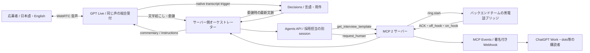

# 採用受付・GPT Live 接続プロトタイプ

目的は「総合受付 → 日英の言語・用件判定 → 採用担当 → 人間に相談」の一本を通すこと。既存の React 画面に組み込む前に、接続境界を試せる Node 24 の独立 workspace です。Workers / Durable Objects / D1 にデプロイ済みの実装ではありません。

## 起動

```sh
npm ci
cp .env.example .env.local
# .env.local のサーバー専用キー・MCP URL・トークンを設定
npm run integration
# 別ターミナル（模擬デバイスのみ）
npm run phone:sim -- --auto
```

画面: http://127.0.0.1:4320/ 。キーはブラウザへ渡しません。既存の `.env.local` がある場合は上書きしないでください。

Agents API が到達できる HTTPS の `/mcp` を `HUMAN_MCP_URL` に設定します。MCP と機器 WebSocket は `HUMAN_MCP_TOKEN` で認証します。ローカル開発用トンネルを使う場合でも、画面と `/api/*` は loopback 限定です。公開版には別途アプリ認証・テナント別権限・永続 case state が必要です。

`npm run integration:test` で Node のテストを実行します。既存フロントは従来どおり `npm run dev`、`npm run build`、`npm run lint` です。

## 接続



`reception` / `recruiting` はそれぞれ別の Agents session。言語と会話履歴を引き継ぎ、Live の声は維持します。声そのものを変えるには新しい Live session が必要です。

Decisions は `route=reception|recruiting` と `language=ja|en` だけを分類します。国籍、能力評価、候補者ランキング、採否は判断しません。採用担当は架空求人の質問・回答整理・人間相談までです。

## フロント向け API

| API | 用途 |
| --- | --- |
| `GET /api/status` | 設定有無・接続機器・相談状態 |
| `POST /api/live/session` `{sdp, language, case_id?}` | WebRTC offer → `{session:{id}, transport:{sdp}, case_id}` |
| `DELETE /api/live/session/:id` | Live 終了と Agents のキャンセル・削除 |
| `GET /api/events` | SSE: routing.updated、backend.*、human.*、文字起こし |
| `POST /api/demo/handoff` | 手動配線試験。AI判断デモではない。実MCP toolを呼ぶ |

WebRTC の HTTP 作成で session は開始済み。`oai-events` で `session.started` を待ち、`session.start` を重ねて送らない。権限のある sideband だけが業務結果を Live に送ります。

## バックエンド・実機チームへ

[human/README.md](human/README.md) の `/mcp` と `/bridge` が接続仕様です。実機は既存回路に合わせたアダプターでこの境界につないでください。ソフト側で電圧や回路方式は決めません。

- `requested` は指令受付、`ringing` は機器 ACK、`accepted` は受話器応答。音声接続完了ではありません。
- simulator は必ず `simulated:true`。実ベル・人間の通話音声の検証にはなりません。
- 発信の再試行は同じ `idempotency_key`、同じ引継ぎ内容。状態はサーバー側を参照。
- 人間との実音声通話・音声経路の切替は別途合意する範囲です。

[events/README.md](events/README.md) に MCP Events の購読・署名・再送仕様があります。Agents API のストリームと MCP Events は別物です。機器の結果はアプリが Agents への入力と Live commentary に戻します。

## 検証境界

MCP・機器シミュレーター・Webhook のローカル試験、実 OpenAI API の試験、ブラウザの音声往復、実機ベルを分けて PR に記録します。HTTP 200 やモデルへのアクセスだけで、その先の接続を完了扱いにしません。

会話・相談状態はこのプロトタイプではメモリ内です。MCP Events の購読/outbox と provider resource ID は ignored の `.integration-state/` に私有保存します。終了時に削除できなかった hosted session ID は `resources.jsonl` の `cleanup:pending` を確認してください。再起動によるケース復旧は未実装です。
