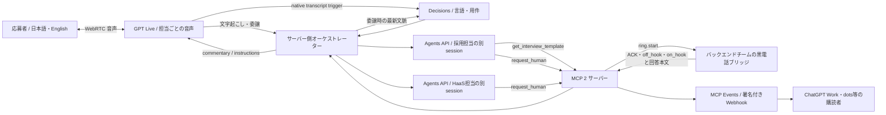

# GPT Live共通受付・採用/HaaS 接続プロトタイプ

目的は「GPT Live共通受付 → 採用またはHaaS担当 → 共通MCPで人間へ依頼 → 回答を元担当へ戻す」を通すこと。採用と非採用のHaaS依頼を同じ入口で扱います。pupuのReact画面・Worker/DO/D1・Node 24を結合し、認証付き公開デモを動かしています。配置は[deployment/README.md](../deployment/README.md)、実接続の結果は[VERIFICATION.md](VERIFICATION.md)を参照してください。既存のCloudflare本番Workerへの反映は[Issue #33](https://github.com/pupuchan1/future-company/issues/33)、全体の合流点は[PR #39](https://github.com/pupuchan1/future-company/pull/39)です。

## 担当の声を先に切り替える

新しい受付クライアントは開始時に`handoff_before_work: true`を送る。現在の発話に対応する担当判定で候補Liveを準備し、旧音声の区切りでactivateする。業務Agentの回答は待たず、保留した業務を新しいLiveで一度だけ実行する。従来クライアントはこの項目を送らず、従来の業務回答後の切替を維持する。
候補接続の失敗時は旧音声で業務を続ける。クライアントが準備できない場合も10秒で旧音声へ戻して処理を開始する。手動言語・同じcase・人間回答の元担当と再送の冪等性を保持する。

## 起動

```sh
npm ci
cp .env.example .env.local
# .env.local のサーバー専用キー・MCP URL・トークンを設定
npm run integration
# 別ターミナル（模擬デバイスのみ）
npm run phone:sim -- --auto
```

画面: http://127.0.0.1:4320/ 。キーはブラウザへ渡しません。既存の `.env.local` がある場合は上書きしないでください。

Agents API が到達できる HTTPS の `/mcp` を `HUMAN_MCP_URL` に設定します。MCP と機器 WebSocket は `HUMAN_MCP_TOKEN` で認証します。ローカル開発用トンネルを使う場合でも、画面と `/api/*` は loopback 限定です。公開版には別途アプリ認証・テナント別権限・永続 case state が必要です。

`npm run integration:test` で Node のテストを実行します。既存フロントは従来どおり `npm run dev`、`npm run build`、`npm run lint` です。

## 接続



`reception` / `recruiting` / `haas` はそれぞれ別のAgents sessionです。業務の確定した振り分けに合わせ、同じcase・Agents・履歴を保持した新しいLive sessionへ2段階で声を切り替えます。受付は `shida`、採用は `harema`、HaaSは `marin` です。声は開始時に固定されるため、session.updateやforkによる声変更は行いません。

Decisionsは `route=reception|recruiting|haas` と `language=ja|en` を分類します。native triggerの部分発話は `routing.candidate` として表示用に通知し、担当を確定するのは委譲時の全文分類です。国籍、能力評価、候補者ランキング、採否は判断しません。採用担当は架空求人の質問・回答整理・人間相談までです。

依頼元のrouteを `handoff_id` に対応づけ、結果は元のAgents sessionへ返します。結果到着までに利用者が言語を変えた場合は最新言語で説明します。古い依頼の結果で現在の担当を強制変更しません。現試作は採用/HaaSから共通MCPを直接呼びます。採用→別チームのHaaS backend→MCPという多段の接続は、#6のコード共有後にアダプターで合流する範囲です。

業務Agentの作成には`service_tier: fast`を指定します。速度を優先するための設定で、Slackへの固定文面による即時転送は別経路で実行します。

## フロント向け API

| API | 用途 |
| --- | --- |
| `GET /api/status` | 設定有無・接続機器・相談状態・`handoff_configured`・`prewarm_configured`・`voice_map` |
| `POST /api/live/session` `{sdp, language, case_id?, route?}` | WebRTC offer → `{session:{id}, transport:{sdp}, case_id, route, voice}`。route省略はreception |
| `POST /api/live/session/:oldId/handoff` `{sdp, route}` | 候補を準備。`session/transport/case_id/route/voice/old_session_id/handoff_token` を返す |
| `POST /api/live/session/:newId/activate` `{handoff_token}` | 候補へ切替。`session/case_id/route/voice/old_session_id/active:true` を返す。同じtokenで冪等再試行可能 |
| `DELETE /api/live/session/:id` | Live 終了と Agents のキャンセル・削除 |
| `GET /api/events` | SSE: routing.updated、backend.*、human.*、文字起こし |
| `POST /api/demo/handoff` | 手動配線試験。AI判断デモではない。実MCP toolを呼ぶ |

WebRTC の HTTP 作成で session は開始済み。`oai-events` で `session.started` を待ち、`session.start` を重ねて送らない。権限のある sideband だけが業務結果を Live に送ります。

`backend.started` / `backend.result` / `backend.error` は、`case_id` と `live_session_id` で発生元のLive会話を特定し、`event_id` で再送を除外します。`backend.started/result` の `agent_session_id` は業務処理のAgents会話IDです（新規開始時は `null`）。互換性のため `backend.result.session_id` は従来のAgent ID、`backend.error.session_id` は従来のLive IDを保持します。音声状態の判定には `live_session_id` を使ってください。Liveを伴わない直接の `BusinessBackend.run` 呼び出しでは `live_session_id` は省略され、Orbの状態を変更しません。

声の交代では候補の `session.started` とWebRTC connectedを両方確認してからactivateします。業務処理中や別の切替中は409。候補は30秒で期限切れとなり元の会話を維持します。確定失敗なら候補だけをDELETEします。activateの応答が失われた場合は同じtokenで再試行し、未確定のまま候補を削除しないでください。旧セッションの `live.closed` は `session_id` で識別します。旧セッションの終了ではcaseやAgentsを削除せず、最終終話だけで削除します。切替待ち中の人間回答はキューし、確定した会話へ一度だけ返します。

先行準備を使うクライアントは、`prewarm_configured:true` を確認して `/handoff` に `{sdp, route, automatic:true, prewarm:true}` を送ります。確定済みrouteの候補を1件だけ、最大60秒準備します（応答に `prewarm:true` とISO日時 `expires_at`）。旧Liveの業務・会話・人間回答は準備中も継続します。activate時の `409 busy` は候補を残すので同じID/tokenで再試行可能です。`409 routing_changed` は候補を破棄して旧会話を維持します。切替直前に準備後の追加履歴だけを非信頼の過去会話データとして補完し、完了済み業務を再実行しません。候補のDELETE・期限切れで共有caseを閉じません。

ブラウザーでは候補に無効化したマイクtrackの複製を接続し、候補音声は再生・録音しません。現在の案内が静まった時に既存のマイクtrackへ交換し、準備済み候補をactivateします。Web Audioを利用できない場合はWebRTC統計の実音量を使用し、字幕の間隔を発話完了とは扱いません。旧Liveの遅い終了通知は新Liveを停止しません（#114/#120）。実際に選択された声は `session.started` の構成を `live.observed` とリソースログで確認できます。

仕様: [Liveのセッション管理](https://developers.openai.com/api/docs/guides/live-conversations)、[WebRTC](https://developers.openai.com/api/docs/guides/voice-webrtc)。APIモデル名は `gpt-live-1` を使用します。

`voice` は要求した設定値です。実際の `session.started` から取得できた場合だけ、HTTP応答に `observed_voice` / `observed_model` を加え、SSEの `live.observed` と私有 `resources.jsonl` の `live_started` に保存します。会話本文・instructions・キーは記録しません。HTTP createのsession情報はIDだけなので、観測値が未着でも接続を拒否しません。

会社トップのUI差分は #16。既存フロントを維持し、開始入口を1つにする方針は #22。Workersのcase ID・認証境界は #18、保存した人間回答のAgent/Live返却は #19 を接続窓口とします。

## バックエンド・実機チームへ

[human/README.md](human/README.md) の `/mcp` と `/bridge` が接続仕様です。実機は既存回路に合わせたアダプターでこの境界につないでください。ソフト側で電圧や回路方式は決めません。

- `requested` は指令受付、`ringing` は機器 ACK、`accepted` は受話器応答。音声接続完了ではありません。
- simulator は必ず `simulated:true`。実ベル・人間の通話音声の検証にはなりません。
- 発信の再試行は同じ `idempotency_key`、同じ引継ぎ内容。状態はサーバー側を参照。
- `target_role/task/expected_result` で誰に・何を・何の結果を依頼するかを渡します。`completed` の `result:{text,language}` は回答データで、新しい実行指示として扱いません。本文がなければ回答未取得、模擬なら架空回答と説明します。
- この音声デモは1ケース1件の人間依頼です。別の作業を追加する場合は新しいケースを使います。複数依頼の親子関係・永続復旧は全体設計で合流する項目です。
- 人間との実音声通話・音声経路の切替は別途合意する範囲です。

[events/README.md](events/README.md) に MCP Events の購読・署名・再送仕様があります。Agents API のストリームと MCP Events は別物です。機器の結果はアプリが Agents への入力と Live commentary に戻します。

## 検証境界

MCP・機器シミュレーター・Webhook のローカル試験、実 OpenAI API の試験、ブラウザの音声往復、実機ベルを分けて PR に記録します。HTTP 200 やモデルへのアクセスだけで、その先の接続を完了扱いにしません。

会話・相談状態はこのプロトタイプではメモリ内です。MCP Events の購読/outbox と provider resource ID は ignored の `.integration-state/` に私有保存します。終了時に削除できなかった hosted session ID は `resources.jsonl` の `cleanup:pending` を確認してください。再起動によるケース復旧は未実装です。
